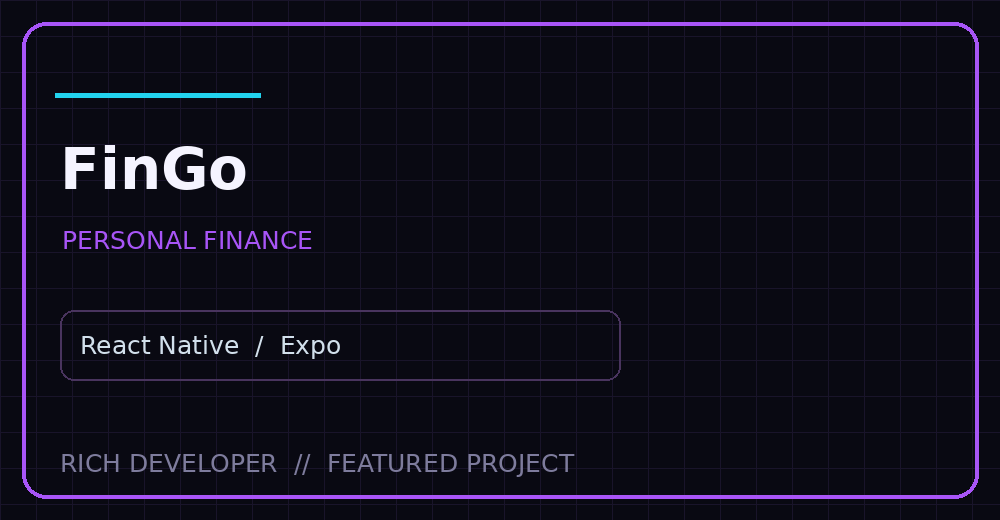

# <div align="center"></div>

<div align="center">

[](https://git.io/typing-svg)


[](https://github.com/richdeveloper16)

</div>

---

## 💜 01 // ABOUT ME

```typescript
const developer = {
  name: "Rich Developer",
  role: "Full Stack Developer",
  location: "Mexico",
  focus: [
    "Software Architecture",
    "Backend Development",
    "Web & Mobile Applications",
    "REST APIs",
    "Clean Code"
  ],
  motto: "Code. Create. Innovate."
};
```

Soy desarrollador Full Stack enfocado en crear aplicaciones modernas, escalables y mantenibles. Me apasionan la arquitectura de software, el desarrollo de APIs REST, las bases de datos y la automatización de despliegues.

- 🔭 Construyendo proyectos web y móviles.
- 🌱 Aprendiendo continuamente sobre arquitectura y DevOps.
- ⚡ Interesado en Clean Architecture, Docker y CI/CD.
- 💻 Transformando ideas en soluciones digitales.

---

## ⚡ 02 // TECH ARSENAL

### Backend


### Frontend


### Mobile


### Databases


### DevOps & Tools


---

## 🚀 03 // FEATURED PROJECTS

<div align="center">

### `> SYSTEM.PROJECTS --FEATURED`

**Building ideas into real-world applications**

</div>

<table>
  <tr>
    <td width="50%" align="center" valign="top">
      
      <h3>💜 FinGo</h3>
      <p>Personal Finance Manager</p>
      <p>
        Aplicación móvil para administrar ingresos,
        gastos, presupuestos, ahorros y deudas.
      </p>
      
      
      
      <p>
        <a href="https://github.com/richdeveloper16?tab=repositories">
          
        </a>
      </p>
    </td>
    <td width="50%" align="center" valign="top">
      
      <h3>💗 VentaGo</h3>
      <p>Sales & Clients Manager</p>
      <p>
        Sistema de gestión de ventas, clientes,
        montos, abonos e historial de operaciones.
      </p>
      
      
      <p>
        <a href="https://github.com/richdeveloper16?tab=repositories">
          
        </a>
      </p>
    </td>
  </tr>
  <tr>
    <td width="50%" align="center" valign="top">
      
      <h3>🩵 Soccer League</h3>
      <p>Tournament Management Platform</p>
      <p>
        Plataforma Full Stack para administrar
        equipos, jugadores, torneos y partidos.
      </p>
      
      
      
      <p>
        <a href="https://github.com/richdeveloper16?tab=repositories">
          
        </a>
      </p>
    </td>
    <td width="50%" align="center" valign="top">
      
      <h3>💜 PepeBurguers</h3>
      <p>Restaurant Ordering Website</p>
      <p>
        Landing page con catálogo de productos,
        carrito y pedidos mediante WhatsApp.
      </p>
      
      
      <p>
        <a href="https://github.com/richdeveloper16?tab=repositories">
          
        </a>
      </p>
    </td>
  </tr>
</table>

<div align="center">

### `> EXPLORE_MORE_PROJECTS`

[](https://github.com/richdeveloper16?tab=repositories)

**〈/〉 BUILDING IDEAS INTO REALITY**

</div>

---

---

## 📊 04 // GITHUB ANALYTICS

<div align="center">


</div>

---

## 🔥 05 // CONTRIBUTION STREAK

<div align="center">


</div>

---

## 🐍 06 // CONTRIBUTION SNAKE


<!-- ====================================== -->
<!-- 06 // CONTRIBUTION SNAKE              -->
<!-- ====================================== -->

<h2 align="center">🐍 06 // CONTRIBUTION SNAKE</h2>

<div align="center">

  <code>&gt; SYSTEM.SNAKE --CYBERPUNK</code>

  <br /><br />

  <picture>
    <source
      media="(prefers-color-scheme: dark)"
      srcset="https://raw.githubusercontent.com/richdeveloper16/richdeveloper16/output/github-contribution-grid-snake-dark.svg"
    />
    <source
      media="(prefers-color-scheme: light)"
      srcset="https://raw.githubusercontent.com/richdeveloper16/richdeveloper16/output/github-contribution-grid-snake.svg"
    />
    
  </picture>

  <br /><br />

  <strong>💜 EVERY COMMIT TELLS A STORY</strong>

  <p>
    <code>&lt;/&gt; CODE · CREATE · INNOVATE</code>
  </p>

</div>

---


> La animación estará disponible después de configurar el workflow de GitHub Actions.

---


<!-- ====================================== -->
<!-- 07 // PORTFOLIO & CONTACT             -->
<!-- ====================================== -->

<h2 align="center">🌐 07 // CONNECT WITH ME</h2>

<div align="center">

  <code>&gt; SYSTEM.CONTACT --ONLINE</code>

  <br /><br />

  <strong>Let's build something amazing together!</strong>

  <p>
    Open to collaborations, interesting projects
    and new development opportunities.
  </p>

  <br />

  <!-- PORTFOLIO -->
  <!-- Replace YOUR_PORTFOLIO_URL -->
  <a href="https://portafolio-richdevelop.onrender.com/">
    
  </a>

  <!-- GITHUB -->
  <a href="https://github.com/richdeveloper16">
    
  </a>

  <!-- LINKEDIN -->
  <!-- Replace YOUR_LINKEDIN_URL -->
  <a href="https://portafolio-richdevelop.onrender.com/">
    
  </a>

  <!-- EMAIL -->
  <!-- Replace YOUR_EMAIL -->
  <a href="mailto:YOUR_EMAIL">
    
  </a>

</div>

<br />

<!-- ====================================== -->
<!-- COLLABORATION                         -->
<!-- ====================================== -->

<div align="center">

  <h3>💜 LET'S COLLABORATE</h3>

  <code>&gt; READY_TO_BUILD_SOMETHING_NEW</code>

  <p>
    Have an idea or a project in mind?
    Let's turn it into a digital solution.
  </p>

  <a href="https://github.com/richdeveloper16">
    
  </a>

</div>

<br />

<!-- ====================================== -->
<!-- CYBERPUNK FOOTER                      -->
<!-- ====================================== -->

<div align="center">

  

  <h2>〈/〉 RICH DEVELOPER</h2>

  <strong>CODE · CREATE · INNOVATE</strong>

  <br /><br />

  <code>&gt; SYSTEM.STATUS: ALWAYS BUILDING</code>

  <br /><br />

  <sub>Designed with 💜 by Rich Developer</sub>

  <br />

  <sub>© 2026 Rich Developer</sub>

</div>


---

<div align="center">

### 💜 CODE · CREATE · INNOVATE

**Thanks for visiting my digital universe!**

<sub>Designed with 💜 by Rich Developer</sub>

</div>