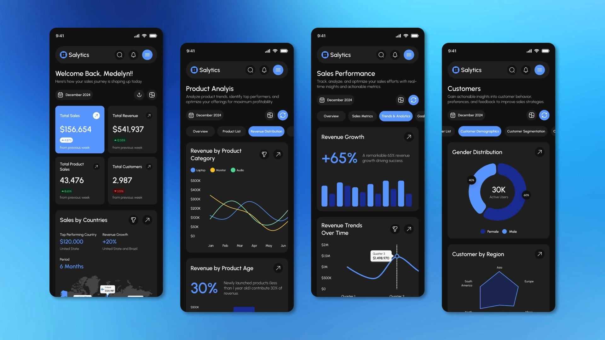
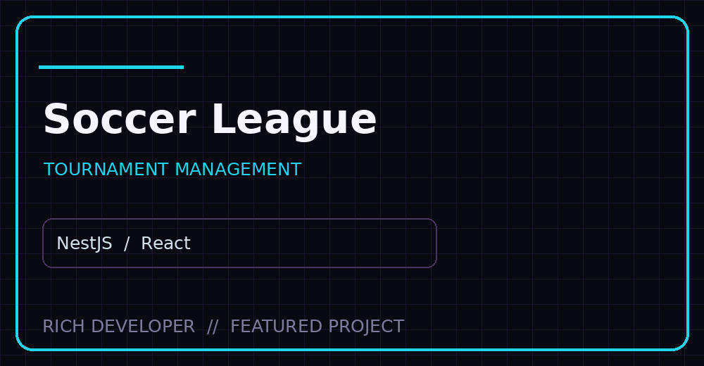
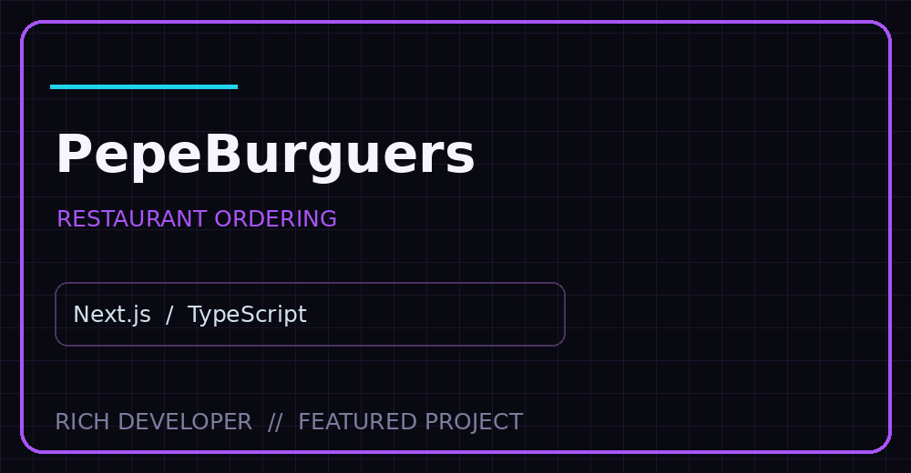

<!-- RICH DEVELOPER | CYBERPUNK GITHUB PROFILE -->
<div align="center">
  
  <br />
  
  <br /><br />
  
  <a href="https://github.com/richdeveloper16"></a>
  <br /><br />
  <code>&gt; SYSTEM.STATUS: ONLINE</code>
  <br />
  <strong>🧬 CODE · CREATE · INNOVATE</strong>
</div>

---

<h2 align="center">🧑‍🚀 01 // ABOUT ME</h2>
<div align="center"><code>&gt; SYSTEM.DEVELOPER --INFO</code></div>

I'm a software developer focused on building modern, scalable, and maintainable applications.

I'm passionate about backend and frontend development, mobile applications, software architecture, and process automation.

I work with technologies such as Java, Spring Boot, NestJS, Angular, React, Next.js, React Native, TypeScript, PostgreSQL, and Docker.

My goal is to turn ideas into functional, professional technology solutions.

```typescript
const developer = {
  username: "richdeveloper16",
  brand: "Rich Developer",
  role: "Full Stack Developer",
  location: "Mexico",
  interests: [
    "Backend Development",
    "Frontend Development",
    "Mobile Applications",
    "Software Architecture",
    "DevOps",
    "Clean Architecture",
  ],
  philosophy: "Code · Create · Innovate",
  status: "Always Learning",
};
```

<div align="center"><strong>Building ideas into real-world applications.</strong></div>

---

<h2 align="center">⚡ 02 // TECH ARSENAL</h2>
<div align="center"><code>&gt; SYSTEM.SKILLS --LIST</code><br /><br /><strong>Technologies &amp; Development Tools</strong></div>

<h3 align="center">⚙️ BACKEND DEVELOPMENT</h3>
<div align="center">
<br /><br />


</div>

<h3 align="center">⚛️ FRONTEND DEVELOPMENT</h3>
<div align="center">
<br /><br />


</div>

<h3 align="center">📱 MOBILE DEVELOPMENT</h3>
<div align="center">
<br /><br />


</div>

<h3 align="center">🗄️ DATABASE MANAGEMENT</h3>
<div align="center">
<br /><br />


</div>

<h3 align="center">🐳 DEVOPS &amp; DEVELOPMENT TOOLS</h3>
<div align="center">
<br /><br />


</div>

<div align="center"><br /><code>&gt; STATUS: ALWAYS LEARNING</code><br /><br /><strong>Learn · Build · Improve · Repeat</strong></div>

---

<h2 align="center">🚀 03 // FEATURED PROJECTS</h2>
<div align="center"><code>&gt; SYSTEM.PROJECTS --FEATURED</code><br /><br /><strong>Building ideas into real-world applications</strong></div>

|                                                                                   💜 FinGo                                                                                   |                                                                                   💗 VentaGo                                                                                   |
| :--------------------------------------------------------------------------------------------------------------------------------------------------------------------------: | :----------------------------------------------------------------------------------------------------------------------------------------------------------------------------: |
|                                                                                                             |                                                                                                           |
|                                                                         **Personal Finance Manager**                                                                         |                                                                          **Sales & Clients Manager**                                                                           |
|                                    Aplicación móvil para administrar ingresos, gastos, presupuestos, metas de ahorro y deudas personales.                                    |                                            Aplicación para administrar ventas, clientes, montos, abonos e historial de operaciones.                                            |
|                                                                       React Native · Expo · TypeScript                                                                       |                                                                           Sales · Clients · Payments                                                                           |
| [](https://github.com/richdeveloper16?tab=repositories) | [](https://github.com/richdeveloper16?tab=repositories) |

|                                                                                   🩵 Soccer League                                                                                    |                                                                                   💜 PepeBurguers                                                                                   |
| :-----------------------------------------------------------------------------------------------------------------------------------------------------------------------------------: | :---------------------------------------------------------------------------------------------------------------------------------------------------------------------------------: |
|                                                                                                      |                                                                                                      |
|                                                                          **Tournament Management Platform**                                                                           |                                                                           **Restaurant Ordering Website**                                                                           |
|                                         Plataforma Full Stack para administrar torneos, equipos, jugadores, categorías y partidos de fútbol.                                          |                                                       Landing page con catálogo de productos, carrito y pedidos por WhatsApp.                                                       |
|                                                                         NestJS · React · Prisma · PostgreSQL                                                                          |                                                                           Next.js · TypeScript · WhatsApp                                                                           |
| [](https://github.com/richdeveloper16?tab=repositories) | [](https://github.com/richdeveloper16?tab=repositories) |

<div align="center">
<a href="https://github.com/richdeveloper16?tab=repositories"></a><br /><br />
<code>&gt; BUILDING IDEAS INTO REALITY</code>
</div>

---

<h2 align="center">📊 04 // GITHUB ANALYTICS</h2>
<div align="center">
<code>&gt; SYSTEM.ANALYTICS --STATUS</code><br /><br />
<strong>Code · Contributions · Development Activity</strong><br /><br />


</div>

---

<h2 align="center">🔥 05 // CONTRIBUTION ACTIVITY</h2>
<div align="center">
<code>&gt; SYSTEM.ACTIVITY --TRACKING</code><br /><br />
<br /><br />
<br /><br />
<strong>💜 EVERY COMMIT TELLS A STORY</strong>
</div>

---

<h2 align="center">🐍 06 // CONTRIBUTION SNAKE</h2>
<div align="center">
<code>&gt; SYSTEM.SNAKE --CYBERPUNK</code><br /><br />
<picture>
<source media="(prefers-color-scheme: dark)" srcset="https://raw.githubusercontent.com/richdeveloper16/richdeveloper16/output/github-contribution-grid-snake-dark.svg" />
<source media="(prefers-color-scheme: light)" srcset="https://raw.githubusercontent.com/richdeveloper16/richdeveloper16/output/github-contribution-grid-snake.svg" />

</picture><br /><br />
<strong>CODE · CREATE · INNOVATE</strong>
</div>

---

<h2 align="center">🌐 07 // CONNECT WITH ME</h2>
<div align="center">
<code>&gt; SYSTEM.CONTACT --ONLINE</code><br /><br />
<strong>Let's build something amazing together!</strong>
<p>Open to collaborations, interesting projects and new development opportunities.</p>
<a href="https://portafolio-richdevelop.onrender.com/"></a>
<a href="https://github.com/richdeveloper16"></a>
<a href="mailto:rich.developer.16@gmail.com"></a>
</div>

<div align="center">
<h3>💜 LET'S COLLABORATE</h3>
<code>&gt; READY_TO_BUILD_SOMETHING_NEW</code>
<p>Have an idea or a project in mind? Let's turn it into a digital solution.</p>
<a href="https://github.com/richdeveloper16?tab=repositories"></a>
</div>

<div align="center">

<h2>〈/〉 RICH DEVELOPER</h2>
<strong>CODE · CREATE · INNOVATE</strong><br /><br />
<code>&gt; SYSTEM.STATUS: ALWAYS BUILDING</code><br /><br />
<sub>Designed with 💜 by Rich Developer</sub><br />
<sub>© 2026 Rich Developer</sub>
</div>
